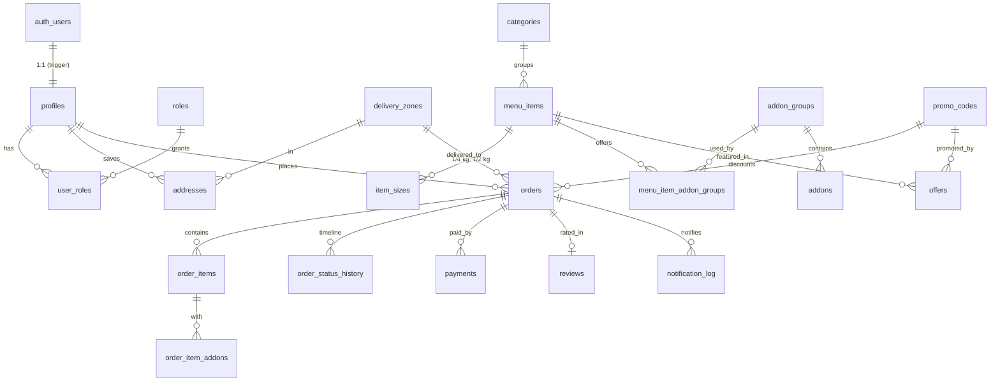

# فحم وزعتر — Fahm & Zaatar · Build plan

Premium ordering + delivery site for an Egyptian/Levantine grill in the Fifth Settlement, New Cairo.
Arabic-first (RTL), English second. Mobile-first. Deploys to Vercel.

---

## 1. Architecture

```
Browser (Next.js App Router, React 19, RSC)
 ├─ Customer pages  /[locale]/…          ar at "/", en at "/en"
 ├─ Admin           /[locale]/admin/…    role-protected (owner · manager · kitchen · driver)
 └─ Client state    Zustand (persisted cart only — never prices of record)

Next.js server (Route Handlers + Server Actions)
 ├─ server/services   orders, pricing, menu, promos, analytics   ← all money math lives here
 ├─ server/auth       Supabase Auth  | local JWT + mock OTP       (same interface)
 ├─ server/payments   COD · Paymob (mock/sandbox/live) · InstaPay (manual review)
 ├─ server/notify     WhatsApp: mock | Meta Cloud API             (same interface)
 ├─ server/realtime   Supabase Realtime broadcast | SSE           (same interface)
 ├─ server/storage    Supabase Storage | local disk               (same interface)
 └─ server/db         Drizzle ORM over node-postgres | PGlite

Postgres  (supabase/migrations/*.sql are the source of truth, incl. RLS)
 ├─ Supabase project            when NEXT_PUBLIC_SUPABASE_URL + keys + DATABASE_URL are set
 └─ Embedded PGlite (WASM PG)   zero-config fallback: same SQL, same RLS, persisted in .data/
```

**Why PGlite for the fallback:** it is real Postgres compiled to WASM, so the *exact* Supabase
migrations (enums, triggers, identity columns, RLS policies, `auth.uid()`) run unchanged — no
"SQLite flavour" drift. A tiny local shim (`supabase/local/`) provides the `auth` schema and the
`anon/authenticated/service_role` roles that Supabase normally supplies. Verified: `npm run db:verify`
passes the same 46 checks on PGlite **and** on stock Postgres 16.

**Vercel:** serverless functions have no persistent disk, so production needs Supabase
(PGlite is for local/demo). Everything else is environment-driven; no code changes to switch.

### Folder structure
```
app/            routes (App Router) — [locale]/…, api/…
components/     ui/ (primitives) · brand/ · menu/ · cart/ · checkout/ · order/ · admin/ · common/
lib/            isomorphic pure logic: money, phone, pricing, hours, order-status, utils
server/         server-only: db/, auth/, payments/, notify/, realtime/, storage/, services/, env.ts
types/          shared TS types
messages/       ar.json · en.json (next-intl)
supabase/       migrations/ (Supabase CLI compatible) · local/ (auth shim, never applied to Supabase)
scripts/        db CLI, schema/RLS verifier, logo + illustration generators, screenshots
tests/          Playwright e2e
public/         brand/ (SVG logo set) · art/ (dish illustrations)
docs/           this plan
```

---

## 2. Database

17 required tables + 4 supporting ones (`menu_item_addon_groups` junction, `user_roles`, `offers`,
`opening_hours`, `notification_log`, `rate_limits`). All money is **integer piasters**.



Key rules enforced **in the database**, not just the app:
- `orders` check: `total = subtotal − discount + delivery (+ VAT when exclusive)`.
- `order_items` check: `line_total = (unit + add-ons) × qty`, qty 1–50.
- Egyptian mobile format `^01[0125][0-9]{8}$` on profiles and orders.
- Order/item/add-on **snapshots** (names, prices, address) so history never changes when the menu does.
- `order_status_history` is written by a trigger on every status change (actor from JWT or `app.actor_id`).
- Guest tracking via an unguessable `tracking_token` (no login needed to track an order).

### Row Level Security (on every table)
| Who | Can read | Can write |
|---|---|---|
| anon | active menu, sizes, add-ons, zones, hours, live offers, published reviews, public settings | nothing |
| customer | + own profile, addresses, orders (+ items, history, payments) | own profile & addresses |
| kitchen | + all orders | — (status changes via server action) |
| driver | + orders assigned to them | — |
| manager / owner | + promo codes, notification log, all settings | menu, zones, hours, offers, promos, settings |
| owner | | staff roles |

There are **no client insert/update policies on orders or payments**: the server recalculates every
price from the database and is the only writer, and only a verified Paymob webhook or a manager's
InstaPay confirmation can mark a payment `paid`. `rate_limits` has RLS on and no policies at all.

---

## 3. Design system (see `/style-guide`)

- **Mood:** charcoal grounds, ember accents, cream type; soft ember glows and film grain for "fire & smoke".
- **Colour:** coal 950–500, ember 200–700 + flame gold, cream/smoke text, za'atar olive (vegetarian/success),
  chili (spicy/errors). All text pairings ≥ 4.5:1 (cream 15.8, secondary 8.5, ember 8.1, dark-on-ember 8.5).
- **Type:** Reem Kufi (Kufic display, headings & brand) + IBM Plex Sans Arabic (UI/body, Arabic + Latin).
  Arabic is never letter-spaced; Arabic line-height 1.7.
- **Digits:** Latin digits in both languages for prices, phones and copy (clearer at small sizes, matches
  how Egyptians type phone numbers). One switch in `lib/money.ts` if you prefer ٠١٢٣.
- **Logo:** text-based SVG, Arabic shaped with HarfBuzz and outlined to paths (no font dependency); mark =
  flame over a grill bar with a za'atar leaf at its heart. Variants: full, mark, app icon, monochrome (tickets).
- **RTL:** logical properties only (`ms/me/ps/pe/start/end`), direction-aware arrows, RTL-aware switches and steppers.
- **Images:** verified Unsplash photos for 15 dishes; 7 dishes without a verified free photo use designed
  illustrations (`public/art`). Any photo that fails to load falls back to an illustration — never a broken image.
- **Motion:** Framer Motion for micro-interactions; everything respects `prefers-reduced-motion`.

---

## 4. Phases

1. **Plan + DB schema + design system** ← *this phase*
2. **Customer menu + cart:** home (hero, featured, offers, hours, map, reviews, WhatsApp), menu with sticky
   categories, search, filters (spicy / vegetarian / best seller), item sheet (sizes, add-ons, notes),
   persisted cart drawer, promo codes, live totals, floating cart button, skeletons, toasts.
3. **Checkout + orders + payment:** delivery/pickup, Egyptian address form + optional map pin, ASAP/scheduled,
   opening-hours guard, server-side pricing, COD / Paymob (mock) / InstaPay upload, order tracking with
   realtime, phone OTP (optional), order history, saved addresses, reorder, rate limiting.
4. **Admin + realtime:** live orders board (sound alert, one-click status, printable kitchen ticket),
   menu CRUD + image upload + sold-out, zones, hours, promos, offers, VAT, InstaPay queue, analytics, roles.
5. **Notifications, SEO, PWA, tests, polish:** WhatsApp provider (mock), metadata/OG/sitemap/JSON-LD
   (Restaurant + Menu), installable PWA, Playwright e2e (browse → cart → checkout → admin sees order),
   Lighthouse ≥ 90 mobile, README + `.env.example`, final screenshots.

---

## 5. Decisions taken (change any of them)

| Topic | Decision |
|---|---|
| Kofta | One dish with sizes ¼ kg 220 / ½ kg 420 (your two menu lines merged, as the size spec implies) |
| Lamb chops ½ kg | **760 EGP** — not in the brief; assumed 2 × 390 − 20 like kofta |
| VAT | 14 %, prices **include** VAT (shown as "incl. VAT" on the receipt); switchable in admin settings |
| VAT base | food after discount + delivery fee |
| Min order | checked against subtotal before discount |
| WELCOME10 | 10 % off, once per phone number, no cap, no minimum |
| Closed hours | ASAP ordering blocked with a clear message; **scheduled** orders for opening time still allowed (setting) |
| Online payments | order stays `pending_payment` (hidden from kitchen) until Paymob confirms / manager confirms InstaPay |
| Pickup flow | Received → Preparing → Ready for pickup → Collected |
| Language | Arabic always at `/` (no browser-language redirect); English at `/en` |
| Staff login | email + password; customers: optional phone OTP (mock code in demo) |
