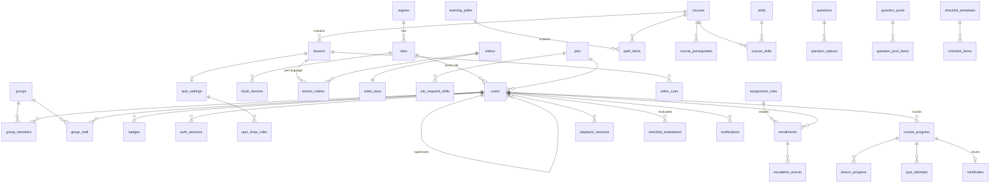

# Facility Training Platform: Architecture Proposal

> **Status:** awaiting your approval. Nothing is implemented yet.
> **Companion file:** [`schema.draft.sql`](./schema.draft.sql) is the full PostgreSQL 16 DDL. It has been
> applied to a real PG16 instance, and the privacy rules, gender triggers and audit trigger were
> tested against seeded data (results in §4.4).

---

## 0. Context and assumptions

* The repo currently holds only `zaad.html`, an unrelated prayer-times prototype. I'll **leave it untouched**
  and build the platform beside it as a monorepo.
* Target: 5,000+ workers, peak **1,000 concurrent**, self-hosted with Docker on company servers, no external
  SaaS holding user data.
* **The one unavoidable exception:** OTP and reminder messages go through the WhatsApp/SMS provider you choose.
  Only the phone number and the message text leave the network. No names and no training data.
* UI languages: **ar (default, RTL), ur (RTL), bn, hi, ne, tl**, plus **en** for admin/trainer screens
  (proposed; costs almost nothing).
* Default time zone `Asia/Riyadh`; the week starts on Sunday (for the weekly report).

---

## 1. Architecture at a glance

```
                    ┌───────────────────────── company server(s) ─────────────────────────┐
 Workers' phones    │  ┌─────────┐  /            ┌────────────┐                            │
 Shared kiosks ────►│  │  Nginx  │──────────────►│ web        │ Next.js PWA (standalone)   │
 Admin browsers     │  │ TLS,    │  /api/*       ├────────────┤                            │
                    │  │ headers,│──────────────►│ api        │ NestJS HTTP (×2+)          │
                    │  │ secure_ │  /hls/*       ├────────────┤                            │
                    │  │ link,   │──┐ (signed,   │ worker     │ NestJS + BullMQ + ffmpeg   │
                    │  │ cache   │  │  cached)   └─────┬──────┘                            │
                    │  └─────────┘  │                  │                                   │
                    │               ▼                  ▼                                   │
                    │         ┌──────────┐   ┌────────────┐  ┌───────┐  ┌───────────┐      │
                    │         │  MinIO   │   │ PostgreSQL │  │ Redis │  │ Gotenberg │      │
                    │         │(internal)│   │     16     │  │  AOF  │  │ (PDF,int.)│      │
                    │         └──────────┘   └────────────┘  └───────┘  └───────────┘      │
                    └──────────────────────────────────────────────────────────────────────┘
        outbound only: WhatsApp/SMS provider (OTP + reminders), company SMTP relay (weekly report)
```

* **MinIO is never exposed publicly.** Uploads come in through the API (resumable tus); playback reads go through
  Nginx's `/hls/` location after the `secure_link` check, with segments cached on Nginx's disk.
* **api** and **worker** share one NestJS codebase with two entrypoints. Only the worker image contains ffmpeg.
* **Gotenberg** (self-hosted HTML→PDF, Chromium inside) renders certificates. It is the only way I know to get
  correct shaping for Arabic, Urdu Nastaliq, Bengali and Devanagari in PDFs. It sits on the internal network only.
  *(This is an addition to your stack; see Decisions.)*

---

## 2. Folder structure

```
.
├── apps/
│   ├── api/                              # NestJS (HTTP API + background worker)
│   │   ├── src/
│   │   │   ├── main.ts                   # HTTP entrypoint
│   │   │   ├── worker.ts                 # BullMQ processors entrypoint (same modules, no HTTP)
│   │   │   ├── app.module.ts
│   │   │   ├── config/                   # zod-validated env + Docker secrets loader
│   │   │   ├── common/                   # guards, interceptors, problem+json filter, request
│   │   │   │                             #   context (AsyncLocalStorage), rate limiting, idempotency
│   │   │   ├── db/
│   │   │   │   ├── schema/*.ts           # Drizzle schema (source of truth)
│   │   │   │   ├── migrations/           # generated SQL + hand-written triggers/RLS/partitions
│   │   │   │   └── tx.ts                 # transaction helper: SET LOCAL app.actor_id/request_id/ip
│   │   │   ├── modules/
│   │   │   │   ├── auth/                 # OTP, sessions, refresh rotation, badges, kiosk devices
│   │   │   │   │   └── otp-channels/     #   OtpChannel interface: whatsapp, sms-http, console
│   │   │   │   ├── access/               # roles, ScopeService (site/region/group + female rule)
│   │   │   │   ├── audit/                # app-level semantic events + audit viewer API
│   │   │   │   ├── org/                  # regions, sites, jobs, groups
│   │   │   │   ├── users/                # users + EmployeeUpsertService (shared by import & HR)
│   │   │   │   ├── media/                # tus upload, transcode processor, key vault, signing
│   │   │   │   ├── content/              # courses, lessons, paths, prerequisites, skills
│   │   │   │   ├── assessment/           # question bank, pools, quizzes, video cues
│   │   │   │   ├── playback/             # sessions, heartbeat (Redis Lua), flusher, unlocking
│   │   │   │   ├── assignments/          # enrollments, auto-assignment rules
│   │   │   │   ├── checklists/           # practical evaluations + offline sync endpoint
│   │   │   │   ├── certificates/         # issue, PDF (Gotenberg), verify, expiry/recert
│   │   │   │   ├── notifications/        # channels, templates, escalation ladder
│   │   │   │   ├── imports/              # Excel import, HR sync API
│   │   │   │   ├── analytics/            # skills matrix, site comparison, KPI snapshots
│   │   │   │   └── reports/              # weekly email
│   │   │   └── jobs/                     # queue names, schedules, processor registry
│   │   ├── test/                         # integration tests (real Postgres/Redis/MinIO)
│   │   └── Dockerfile                    # targets: api, worker (worker adds ffmpeg)
│   │
│   └── web/                              # Next.js App Router PWA
│       ├── src/
│       │   ├── app/
│       │   │   ├── [locale]/
│       │   │   │   ├── (auth)/login, kiosk/
│       │   │   │   ├── (worker)/home, paths/[id], lessons/[id], quiz/[id], certificates/
│       │   │   │   ├── (supervisor)/team, checklists/   (offline-capable)
│       │   │   │   └── (admin)/users, org, groups, videos, content, paths, questions,
│       │   │   │                rules, imports, analytics, reports, audit, settings
│       │   │   └── verify/[code]/        # public certificate verification
│       │   ├── features/
│       │   │   ├── player/               # hls.js player, controls, watermark, cue overlay, heartbeat
│       │   │   ├── offline/              # Dexie (IndexedDB) store, outbox, sync engine
│       │   │   ├── kiosk/                # badge scanning (on-device decode), idle logout
│       │   │   └── path-builder/         # dnd-kit drag-and-drop editor (RTL-aware)
│       │   ├── components/ui/            # design system (Tailwind, logical properties)
│       │   ├── lib/api/                  # typed client generated from shared zod schemas
│       │   ├── i18n/                     # next-intl config, locale -> dir/font mapping
│       │   └── sw.ts                     # Serwist service worker (shell + offline checklists only)
│       ├── messages/{ar,ur,bn,hi,ne,tl,en}.json
│       └── Dockerfile
│
├── packages/
│   ├── shared/                           # zod schemas, DTO types, enums, constants
│   │                                     #   (UNLOCK_THRESHOLD=0.95, HEARTBEAT_S=10, ...)
│   └── config/                           # tsconfig, eslint, prettier, tailwind preset
│
├── infra/
│   ├── nginx/                            # nginx.conf, app.conf.template, secure_link, headers
│   ├── postgres/                         # init roles (owner/app/worker), postgresql.conf tuning
│   ├── minio/                            # bucket bootstrap + policies
│   ├── compose/
│   │   ├── docker-compose.yml            # base services
│   │   ├── docker-compose.dev.yml        # hot reload, exposed ports, console OTP
│   │   ├── docker-compose.staging.yml    # seed data, test OTP mailbox, smaller limits
│   │   └── docker-compose.prod.yml       # replicas, limits, secrets, restart policies
│   ├── env/*.env.example
│   └── scripts/                          # backup.sh, restore.sh, verify-backup.sh,
│                                         #   rotate-kek.sh, seed.sh, partitions.sh
├── tests/
│   ├── e2e/                              # Playwright (per-locale, player, offline, kiosk)
│   └── load/                             # k6 scenarios (1,000 VUs)
├── docs/                                 # this proposal, ADRs, runbooks, API (OpenAPI)
├── .github/workflows/ci.yml              # lint, typecheck, unit, integration, e2e
├── pnpm-workspace.yaml
└── zaad.html                             # existing file, untouched
```

**Tooling:** pnpm workspaces, TypeScript strict, Vitest (unit and integration across api/web/shared),
Playwright, k6. **ORM: Drizzle** (recommended over Prisma for this project because it handles SQL-first
migrations, check constraints, partial indexes, partitions, triggers and RLS without fighting drift detection).

---

## 3. Key design decisions

### 3.1 Roles, hierarchy, privacy

| Capability | admin | trainer | supervisor | worker |
|---|---|---|---|---|
| Org, users, groups, rules, imports, settings | ✅ (global, or one region) | – | – | – |
| Upload videos, author courses/paths/questions/checklists | ✅ | ✅ | – | – |
| See learners' progress | all in scope | groups assigned to them | own site | self |
| Assign training | ✅ | assigned groups | own site | – |
| Practical checklist evaluations | ✅ | – | own site | – |
| Analytics / heatmap / site comparison | ✅ | assigned groups | own site | – |
| Audit log viewer | ✅ | – | – | – |

**Female-worker privacy rule** (proposed reading of *"female groups visible only to assigned female
supervisors/trainers"*):

1. Female workers may only belong to **female_only** groups. Female_only groups only accept **female staff**.
   A female worker's direct supervisor must be female. All three are enforced by DB triggers.
2. A female worker's personal data (name, phone, employee number, per-person progress) is visible only to
   **herself**, **female staff assigned to one of her groups**, and **female admins with an explicit
   `female_data_access` grant**. Male admins, male supervisors and unassigned staff see her **only inside
   aggregate numbers** (site completion %, counts).
3. Enforcement has three layers:
   1. App-level `ScopeService` composed into every query.
   2. **Postgres Row-Level Security on `users`**, which fails closed: if a query forgets the scope, her row
      simply doesn't come back.
   3. An automated **privacy contract test** that calls every list/export endpoint as a male
      admin/supervisor/trainer and asserts no female-worker identifier appears.
4. Escalations or reports about female workers that go to male recipients are aggregated without names.

**No face capture anywhere:**
* No avatars (initials only).
* No photo field anywhere, including checklists.
* No webcam proctoring.
* The camera is used only to scan QR codes, decoded on the device frame by frame and never stored or uploaded.
  USB/Bluetooth badge scanners are also supported.
* `Permissions-Policy: camera=()` is set everywhere except the two scan screens.

### 3.2 Authentication
* **Phone + OTP:**
  * 6-digit code, stored in Redis only as an HMAC with a 5-minute TTL.
  * Max 5 tries per code. Rate limits per phone (1/min, 5/h) and per IP.
  * Lockout after repeated failures. The same response is returned whether or not the number is registered.
* **`OtpChannel` interface** with adapters: `whatsapp` (Cloud API or your BSP), `sms-http` (generic gateway,
  e.g. a local KSA provider), and `console` (dev/staging). WhatsApp is tried first, with an SMS fallback button.
* **Sessions:**
  * 15-minute access JWT (EdDSA) plus a rotating refresh token, both in httpOnly `SameSite=Strict` cookies.
  * Reuse of a refresh token revokes its whole family. "Log out everywhere" is supported.
* **QR badge login on shared devices:**
  * The badge holds an opaque 256-bit random token, **not** the employee number. Badges can be revoked and
    reissued, with one active badge per worker.
  * Badge login works only on **kiosk devices registered to a site**, and only for workers of that site.
  * Kiosk sessions have no refresh token, log out after 5 minutes idle, and have a big "switch user" button.

### 3.3 Video pipeline
1. **Upload:** admin/trainer uploads through **tus** (resumable, good for big files on weak links) to the
   MinIO `originals` bucket. `ffprobe` validates the file.
2. **Transcode:** a BullMQ job runs on the worker. One ffmpeg pass produces 360p/480p/720p HLS
   (6-second segments, aligned keyframes, VOD playlists, poster image) with **AES-128**: one random 16-byte
   key and IV per video.
3. **Key storage:** the key is wrapped with **AES-256-GCM** under a KEK from a Docker secret and stored in
   `video_keys`. The KEK can be rotated with a script.
4. **Key endpoint** `GET /api/v1/playback/keys/:videoId?ps=…` requires all of: an authenticated user, an
   entitlement (enrolled and lesson unlocked, or staff), the **active playback session** for that user and
   video, and a rate limit. It returns the key with `Cache-Control: no-store`.
5. **Segments** are served at `/hls/{videoId}/…?st=…&e=…&ps=…`. Nginx `secure_link` checks
   `md5(expiry + videoId + playbackSession + secret)` with a **~120-second expiry**, then proxies to MinIO
   with a disk cache.
6. **Token refresh rides on the heartbeat:** every heartbeat response carries a fresh token, which hls.js
   applies through `xhrSetup`. If heartbeats stop, the stream stops within about 2 minutes.
7. Optional per-language WebVTT subtitles.

### 3.4 Player (hls.js, custom controls)
* **Rewind only:** seeking past `maxWatched` (the server frontier) snaps back. Playback rate is forced to 1×
  (`ratechange` resets it, and the server double-checks).
* **No download or casting:** no native controls, `controlsList="nodownload noremoteplayback"`,
  `disablePictureInPicture`, `disableRemotePlayback`, context menu blocked.
* **Pauses** on `visibilitychange`, `pagehide`, and PiP attempts.
* **Fullscreen** applies to the *container*, so the watermark stays visible. iPhone Safari can't fullscreen
  an element, so it gets a CSS pseudo-fullscreen.
* **Moving watermark** shows employee number, session code and time. It jumps every 7–15 s. A
  `MutationObserver` and style checks pause playback and flag tampering if it is hidden.
* **In-video questions** pause playback at their timestamp and are answered against the server, which never
  sends answers in advance. A required cue that hasn't been answered **caps the server frontier**, so it
  can't be skipped.
* **One active playback session per user.** Starting on another device ends the old session.

### 3.5 Progress and unlocking (server-authoritative)
* **Heartbeat** `POST /api/v1/playback/sessions/:ps/heartbeat` every 10 s with `{position, state, rate, seq}`.
* **Validation:** an atomic **Redis Lua** script uses a **real-time budget** (token bucket). Budget grows at
  1 s per wall-clock second, measured on the server clock, and is capped at 30 s so pausing can't bank
  credit. Moving the frontier forward consumes budget.
  * A heartbeat that asks for more than the budget → **rejected** (`422 PROGRESS_TOO_FAST`), counted on the
    session, and the client resyncs to the server frontier.
  * Long-run guarantee: frontier advance ≤ wall time + 30 s, whatever the client sends.
* **Buffering:** Redis holds per-session state plus a dirty set. A flusher job every ~15 s batch-upserts
  `lesson_progress` and `playback_sessions` with monotonic `GREATEST()` merges, so writes are idempotent
  and safe to replay.
* **Load:** 1,000 viewers ≈ 100 heartbeats/s to Redis, and about one batched write of ~1,000 rows to
  Postgres every 15 s.
* **Completion:** when the frontier reaches **≥ 95 %** of the duration and all required cues are answered,
  the heartbeat path writes completion **synchronously** (not waiting for the flusher), audits it, and
  re-evaluates the course, path and certificate.
* **Unlocking is computed on the server** at every gate: `play`, `key`, `quiz start`. Gates are: previous
  lesson complete (video ≥ 95 %, quiz passed, checklist passed), course prerequisites met (DAG), and the
  previous course in a sequential path complete.

### 3.6 Learning features
* **Paths:** drag-and-drop ordering of courses in a path and lessons in a course (dnd-kit, keyboard and RTL
  aware). Deferred unique constraints make each reorder one atomic transaction. Prerequisites form a DAG
  with cycle detection.
* **Language variants:** a lesson can have one video per language (dubbed). Workers get their language and
  fall back to Arabic. Questions can carry **per-language audio** for low-literacy workers.
* **Question bank:** pools, tags and difficulty. Quiz *draw rules* (e.g. "5 from pool A, difficulty 2, plus
  3 from pool B") are drawn on the server, and each attempt freezes its paper. Configurable attempts,
  cooldown and time limit.
* **Practical checklists** (offline-capable):
  * Versioned templates with critical items.
  * The supervisor's PWA caches the roster and templates in IndexedDB. Evaluations get a device-generated
    UUIDv7, so sync is idempotent.
  * The outbox syncs with Background Sync or on reconnect. Scope is re-checked at sync.
  * The worker acknowledges by scanning their badge.
* **Certificates:**
  * Issued on completion. PDFs are rendered by Gotenberg in the worker's language.
  * The QR code links to `/verify/{random-code}`. That page reads only the frozen snapshot and shows status,
    course, dates and a masked identity.
  * Certificates can be revoked or superseded.
* **Expiry and escalation:**
  * Reminders go out 30/14/7/0 days before expiry, followed by automatic **recertification** enrollment.
  * Overdue escalation follows a configurable ladder (worker → supervisor → region admin), and each step
    fires only once.

### 3.7 Admin data
* **Excel import:** download the template, upload, then **validate and preview the diff**
  (create/update/deactivate/errors), then apply. An error report can be downloaded as XLSX. Phones are
  normalised to E.164 (`05x…` → `+9665x…`).
* **HR sync API:** HMAC-signed requests with a timestamp for replay protection, an IP allowlist, idempotent
  batch upsert and terminate. It uses the **same** `EmployeeUpsertService` as the Excel import.
* **Auto-assignment rules** match on job, site, region, language, gender and "hired within N days". They are
  evaluated on user changes, on rule changes (backfill), and in a nightly reconciliation. They support
  recurrence.
* **Skills matrix heatmap:** site × skill aggregates that drill down to worker × skill. Cells are
  valid / expiring / expired / in progress / missing, based on the skills each job requires. The source is
  a materialized view refreshed every ~10 minutes.
* **Site comparison:** KPIs and trends from nightly `site_kpi_daily` snapshots.
* **Weekly email:** sent through the company SMTP relay on Sunday at 07:00 (Riyadh time). RTL HTML plus an
  XLSX attachment, scoped to each recipient.

### 3.8 i18n and PWA
* next-intl with `/[locale]/…` routes. `dir` and the font follow the locale. Tailwind **logical properties
  only** (`ms-`/`me-`/`ps-`/`pe-`), so one layout serves both RTL and LTR.
* **Self-hosted fonts** (no Google Fonts): IBM Plex Sans Arabic, Noto Nastaliq Urdu (with tuned line
  height), Noto Sans Bengali, Noto Sans Devanagari, and Inter for tl/en.
* The service worker caches the app shell, fonts and translations, plus offline checklist data. It **never**
  caches video, keys or API responses.

### 3.9 Audit
* **Generic trigger audit** on every business table. It records actor, request id, IP and a **column-level
  diff**. Hash columns are redacted and `video_keys` is excluded.
* The app adds **semantic events** for things the triggers don't see: login, OTP failures, badge login,
  exports, refresh-token reuse.
* The log is **append-only**: the app role has no UPDATE/DELETE/TRUNCATE. It is partitioned by month.
* Proposed scope: every business state change, including progress *status transitions*. **Not** every
  10-second position update; those are summarised per playback session. Logging every heartbeat would be
  about 8 million rows a day.

---

## 4. Database schema

The full DDL is in [`schema.draft.sql`](./schema.draft.sql): 54 tables, 1 materialized view, partitioned
audit and playback tables, RLS and triggers.

### 4.1 Entity map



### 4.2 Tables by domain

| Domain | Tables |
|---|---|
| Org | `regions`, `sites`, `jobs`, `users`, `groups`, `group_members`, `group_staff` |
| Auth | `auth_sessions`, `badges`, `kiosk_devices`, `api_clients` (OTP lives in Redis only) |
| Media | `videos`, `video_keys`, `video_subtitles` |
| Content | `courses`, `lessons`, `lesson_videos`, `learning_paths`, `path_items`, `course_prerequisites`, `skills`, `course_skills`, `job_required_skills` |
| Assessment | `questions`, `question_options`, `question_pools`, `question_pool_items`, `quiz_settings`, `quiz_draw_rules`, `video_cues` |
| Assignment | `assignment_rules`, `enrollments`, `escalation_policies`, `escalation_events` |
| Progress | `course_progress` (one *round* per pass; round 2+ = recertification), `lesson_progress`, `playback_sessions` (partitioned), `quiz_attempts`, `quiz_answers`, `cue_responses` |
| Practical | `checklist_templates` (versioned), `checklist_items`, `checklist_evaluations` (device UUID), `checklist_evaluation_items` |
| Certificates | `certificates` (random code, frozen snapshot, expiry, revoke/supersede) |
| Notifications | `notification_templates` (key × channel × language), `notifications` (dedupe key) |
| Admin data | `import_jobs`, `import_rows`, `report_subscriptions`, `report_runs`, `site_kpi_daily`, `app_settings`, `mv_worker_skill_status` |
| Audit | `audit_log` (partitioned monthly, append-only) |

### 4.3 Notable modelling choices
* **UUIDv7 primary keys**, generated by the app. They are time-ordered for index locality, and devices can
  create them offline.
* **`localized_text` domain:** jsonb with Arabic required. Simpler than six translation tables for a fixed
  set of languages.
* **Rounds** (`course_progress.round`) keep recertification history without overwriting earlier completions.
* **Enrollment = path or single course** (enforced by a check constraint). `cycle` supports recurring
  training.
* **Certificates verify from a snapshot.** The public page never joins `users`, so RLS and renames can't
  break or leak it.
* **Login bypasses RLS only through two narrow `SECURITY DEFINER` functions** that return only id and
  status. The app role can't read female workers' rows before authentication.

### 4.4 What I verified on the draft (PostgreSQL 16.15)

| Check | Result |
|---|---|
| Full DDL applies cleanly | ✅ |
| Female worker into a mixed group / male staff into a female group / female worker reporting to a male supervisor / male admin granted female access | ✅ all four rejected |
| RLS visibility (app role) for no actor, male admin, male supervisor, unassigned female supervisor | ✅ male worker only |
| RLS visibility for female admin (granted), assigned female supervisor, the worker herself | ✅ both workers |
| Male supervisor `UPDATE`s a female worker | ✅ 0 rows affected |
| Audit row has actor + column diff (`{"preferred_language":["ar","ur"]}`) | ✅ (after fixing a NULL-`TG_ARGV` bug that dropped every diff) |
| App role `DELETE FROM audit_log` | ✅ permission denied |
| Badge `token_hash` absent from audit | ✅ redacted |

---

## 5. Milestones

Each milestone ends with: migrations, unit and integration tests, Playwright e2e for its screens, seed data,
updated docs, all green in CI, then a **pause for your review** before the next one.

| # | Milestone | Size |
|---|---|---|
| M0 | Foundations | M |
| M1 | Identity, org, access control, audit | L |
| M2 | Secure video pipeline | L |
| M3 | Content authoring and question bank | L |
| M4 | Learner player, progress, unlocking, quizzes | XL |
| M5 | Assignments, notifications, escalation | M |
| M6 | Offline checklists and certificates | L |
| M7 | Admin data and analytics | L |
| M8 | Production hardening, load test, operations | L |

### M0 — Foundations
* Build: pnpm monorepo, shared configs, and the `shared` package.
* Build the NestJS skeleton:
  * zod config and Docker secrets loader
  * pino logs and request IDs
  * health/readiness endpoints, OpenAPI, problem+json errors
* Set up the database: Drizzle with a migration runner, plus the DB roles `owner`/`app`/`worker`.
* Build the Next.js skeleton:
  * next-intl with 7 locales and RTL/LTR switching
  * self-hosted fonts, Tailwind with logical properties
  * PWA manifest and a Serwist shell
* Infrastructure:
  * multi-stage, non-root Dockerfiles
  * compose base, dev and staging files
  * Nginx with security headers and a strict CSP
  * CI workflow
* Tests: config validation (unit), migrations up/down (integration), and Playwright smoke tests that check
  each locale renders with the correct `dir` and font.
* Done when: `docker compose up` serves the localized shell over HTTPS and `/api/health` is green.

### M1 — Identity, org hierarchy, access control, audit
* Org and identity:
  * schema for regions, sites, jobs, users and groups
  * audit trigger and per-transaction actor context
  * RLS on `users`, gender triggers
* Authentication:
  * OTP with WhatsApp, SMS-HTTP and console adapters, rate limits and lockout
  * sessions with refresh rotation and reuse detection
* Badges and kiosks:
  * badge issue, reissue and revoke, with a printable badge sheet
  * kiosk device registration and badge login (camera decode or HID scanner), idle logout
* Access and UI:
  * `ScopeService` and permission guards
  * admin CRUD for org, users and groups
  * audit log viewer
* Tests:
  * **authz matrix** (role × endpoint)
  * **privacy contract test**
  * SQL-level RLS tests
  * OTP brute-force and rate-limit tests, refresh reuse
  * an audit row for every mutation
  * Playwright: OTP login (console channel), kiosk badge login, RTL admin screens

### M2 — Secure video pipeline
* tus upload to MinIO with ffprobe validation and size/type limits.
* Transcode job:
  * one-pass 360/480/720 HLS with AES-128 and a poster
  * retries and status tracking
* Key vault with KEK wrapping and a rotation script.
* Key endpoint and the Nginx `secure_link` + cache config.
* Subtitles, and the admin video library (upload progress, status, staff preview).
* Tests:
  * Transcode a generated 20-second clip, then assert 3 renditions, `#EXT-X-KEY:METHOD=AES-128`, that
    segments are unreadable without the key, and that they decrypt with it.
  * Signed URLs: valid, expired, tampered, and pointing at another video.
  * Key endpoint authz.
  * Playwright: upload → ready.

### M3 — Content authoring and question bank
* Courses, lessons, language variants, skills and prerequisites (with cycle check).
* Paths with a drag-and-drop builder.
* Publish validation: an Arabic variant is required, and the question pools must hold enough questions for
  the draw rules.
* Question bank: options, images, per-language audio, pools and tags.
* Quiz settings and draw rules.
* **Cue editor** for in-video questions: pick timestamps on a preview player.
* Tests: DAG cycles, atomic reorder, publish rules, draw feasibility; Playwright drag-and-drop in RTL.

### M4 — Learner experience: player, progress, unlocking, quizzes
* Worker home: assigned paths, the next lesson, progress. Large touch targets, icons and audio.
* Playback sessions.
* The full custom player (§3.4).
* Heartbeat with the Lua budget validator, the flusher, and synchronous completion at ≥ 95 % with unlock.
* In-video cues, and quizzes (random draw, attempts, cooldown, scoring).
* Tests:
  * **property tests**: no heartbeat sequence can advance faster than real time
  * flusher crash and replay idempotency
  * unlock rules
  * quiz responses never contain answers
  * Playwright: forward seek snaps back, rate is forced to 1×, playback pauses on tab hide, the watermark
    stays visible in fullscreen, a cue blocks progress
  * first k6 heartbeat test

### M5 — Assignments, notifications, escalation
* Manual assignment by user, group or site.
* Auto-assignment rules with backfill, nightly reconciliation and recurrence.
* Notification service: WhatsApp templates, SMS, in-app and staff email; per-language templates, dedupe,
  retries and delivery status.
* Overdue escalation ladder.
* Supervisor team dashboard.
* Tests: rule-matching tables, idempotent backfill, escalation with a fake clock, female-worker escalations
  aggregated for male recipients.

### M6 — Practical checklists (offline) and certificates
* Checklist templates and the supervisor evaluation UI, working offline:
  * Dexie storage, an outbox and the sync engine
  * worker acknowledgement by badge scan
* Certificate issuance with Gotenberg PDFs in all 7 languages.
* The `/verify/{code}` page, revoke and supersede, and the worker's certificate wallet.
* Expiry reminders and automatic recertification.
* Tests:
  * Playwright offline: create evaluations offline, reconnect, and check they are synced exactly once
  * PDF snapshot per language
  * verify-page states
  * expiry jobs with time travel

### M7 — Admin data and analytics
* Excel import (template, validate, preview, apply, error report).
* HR sync API with an OpenAPI document for the HR team.
* Skills matrix heatmap, site comparison, scoped and audited exports.
* Weekly email report.
* Tests:
  * import edge cases: Arabic names, `05x`/`+966` phones, duplicates, a female worker under a male
    supervisor
  * HR API signatures and replay
  * materialized-view correctness
  * report scoping

### M8 — Production hardening, load, operations
* Production compose: replicas, resource limits, health checks, secrets.
* Backup scripts:
  * nightly `pg_dump` (optional WAL archiving)
  * MinIO originals mirror
  * `age` encryption, 7 daily / 4 weekly / 12 monthly retention
  * `restore.sh` and an automated restore check
  * KEK escrow procedure
* **k6 with 1,000 concurrent VUs**: login → home → play → heartbeats → segments → quiz. Thresholds:
  p95 API < 300 ms, < 0.1 % errors. Then tuning.
* Security pass: CSP, rate limits, dependency audit, DAST scan, threat model.
* Optional Prometheus/Grafana.
* Runbooks: install, upgrade, restore, key rotation.

---

## 6. Risks and honest limits

1. **Browsers cannot stop screen recording.**
   * AES-128 + authenticated keys + short-lived signed URLs stop casual downloading and link sharing.
   * They do **not** stop a logged-in user with devtools from saving a lesson. Real DRM
     (Widevine/FairPlay) needs commercial licence servers.
   * The **moving watermark with the employee number** is the actual deterrent, because it makes any leak
     traceable.
2. **Bandwidth is the real scaling limit.** 1,000 concurrent viewers × about 1 Mbps on average ≈ **1 Gbps
   outbound** from your server.
   * Mitigations: adaptive bitrate capped to player size (phones rarely need 720p) and the Nginx segment
     cache.
   * Please confirm the uplink. Multi-site offices may later want a per-site cache node.
3. **iOS:** hls.js works on iOS 17.1+. Older iPhones fall back to native HLS. Server-side progress rules
   still hold there, but client-side seek blocking is weaker.
4. **Offline checklists** use the device clock for `performed_at`. The server also stores `received_at` and
   rejects future timestamps.
5. **This build environment has no Docker daemon.** I'll run integration tests against the local
   PostgreSQL 16 / Redis 7 / ffmpeg 6 installed here, and they will also run with containers in CI. Full
   `docker compose` and k6 runs need to happen on your staging server or in CI. I'll provide the commands
   and the expected output.

---

## 7. Decisions I need from you

| # | Question | My default if you don't object |
|---|---|---|
| D1 | Can **male admins** see female workers' personal data? | **No.** Only female admins with an explicit grant. Male admins see aggregates. |
| D2 | Shared-device login: **badge only**, or **badge + 4-digit PIN**? | Badge only, restricted to registered kiosks of the worker's own site, 5-minute idle logout. |
| D3 | WhatsApp/SMS **provider(s)**? | Build the interface, a WhatsApp Cloud API adapter, a generic HTTP-SMS adapter and a console adapter. You name the vendor before go-live. |
| D4 | ORM | **Drizzle** (Prisma is possible, but it fights triggers/RLS/partitions). |
| D5 | Add **Gotenberg** container for certificate PDFs | Yes (self-hosted, internal network only). |
| D6 | Add **English** for admin/trainer UI | Yes. |
| D7 | What should the public certificate verify page show? | Status, course, dates, site, **masked** name (e.g. "M*** A***") and the last 4 digits of the employee number. Full details for logged-in staff only. |
| D8 | Audit granularity | Every business state change + auth events. Heartbeats are summarised per playback session. |
| D9 | Workflow | One milestone at a time, pushed to `claude/peaceful-knuth-zmmyqf`, with a pause for your review after each one. |
